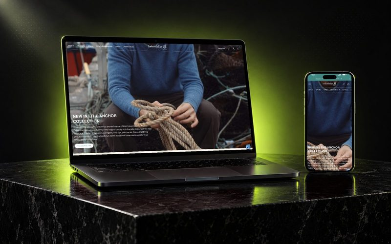
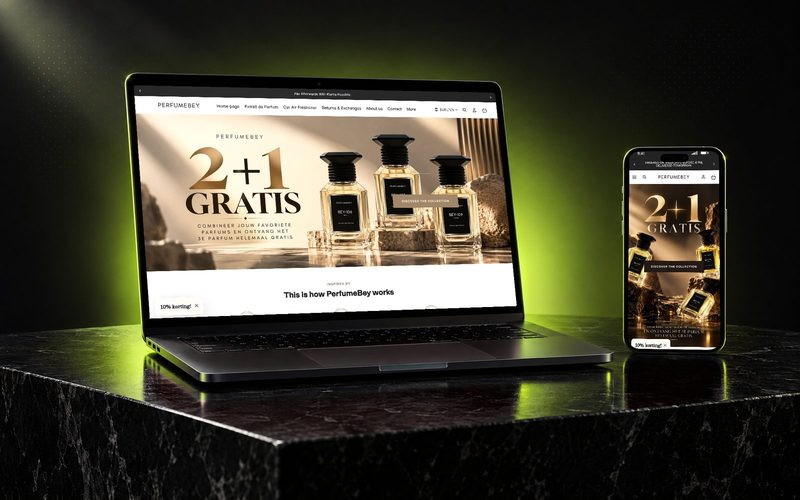
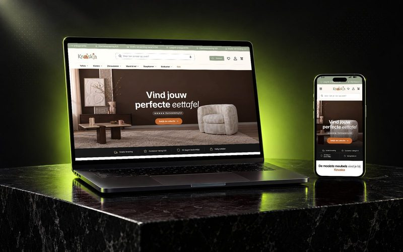
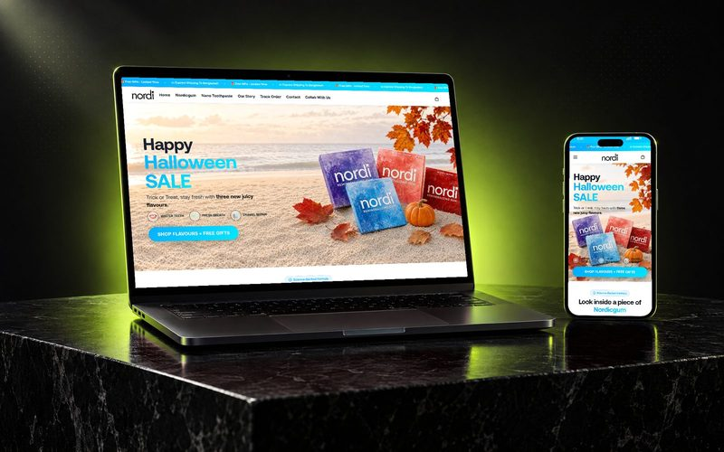
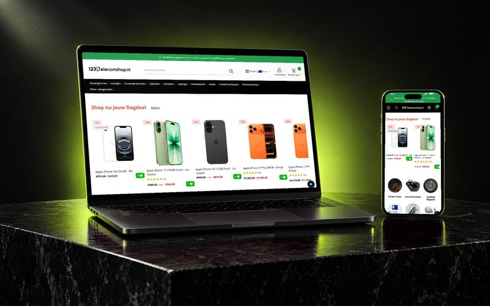

<picture>
  <source media="(prefers-color-scheme: dark)" srcset="https://raw.githubusercontent.com/coderasraf/coderasraf/master/assets/banner-dark.svg" />
  
</picture>

  
  
  
  
  

### Hi, I’m Ashraf 👋

I’m an independent **Shopify developer, CRO specialist and Shopify Partner** based in Sylhet, Bangladesh, working with brands in the US, UK and Europe.

I find what stops visitors from buying, then fix it in the storefront with conversion-focused design, clean Liquid and JavaScript, custom apps and automation. I don’t stop at a report: every change gets shipped and measured.

### 🛠️ What I do

| | Service | What it covers |
|:---:|---|---|
| 📈 | **[Shopify CRO](https://ashraf-siddik.com/services/shopify-cro/)** | Audits, funnel analysis, heatmaps and A/B tests that turn more visitors into buyers |
| 🎨 | **[Shopify development](https://ashraf-siddik.com/services/shopify-development/)** | Custom Online Store 2.0 themes, redesigns, Figma to Shopify, Shopify Plus |
| 🧩 | **[Custom Shopify apps](https://ashraf-siddik.com/services/shopify-app-development/)** | Admin & Storefront API, webhooks, theme app extensions |
| ⚡ | **[SEO & speed](https://ashraf-siddik.com/services/shopify-seo-speed/)** | Core Web Vitals, technical SEO, structured data, safe migrations |
| 🤖 | **[AI & automation](https://ashraf-siddik.com/services/shopify-ai-automation/)** | Shopify Flow, n8n, Make, Zapier and OpenAI/Claude workflows that remove manual work |

### 🛍️ Live Shopify stores I’ve built

<table>
  <tr>
    <td width="33%" valign="top"> <b><a href="https://irelandseyeknitwear.com/">IrelandsEye Knitwear</a></b> Fashion & knitwear</td>
    <td width="33%" valign="top"> <b><a href="https://perfumebey.com/">PerfumeBey</a></b> Beauty & fragrance</td>
    <td width="33%" valign="top"> <b><a href="https://knuska.nl/">Knuska</a></b> Furniture & home</td>
  </tr>
  <tr>
    <td width="33%" valign="top"> <b><a href="https://nordicgum.com/">Nordic Gum USA</a></b> Health & oral care</td>
    <td width="33%" valign="top"> <b><a href="https://123telecomshop.nl/">123TelecomShop</a></b> Consumer electronics</td>
    <td width="33%" valign="middle" align="center"><a href="https://ashraf-siddik.com/work/"><b>See more work →</b></a> Case studies & projects</td>
  </tr>
</table>

### 💬 What clients say

> **★★★★★** Very professional and deep understanding of the Shopify ecosystem. Friendly and proactive communication. Delivered on time with good quality
>
>  <b>ilyam802</b>, United Kingdom · Custom coding

> **★★★★★** Maybe the 10 time working together! Love him! Very good work and much faster than expected. Agreed to deliver within 10-15 days, but it was ready after 8 days.
>
>  <b>rensvermeijden</b>, Netherlands · Store design

> **★★★★★** Great work delivered once again! I have worked with several people but Ashraf surpasses them all. Very clear communication. In my opinion, Ashraf is of value in any business🙌
>
>  <b>michon61</b>, Netherlands · Custom coding

Real reviews, quoted word for word. <a href="https://ashraf-siddik.com/reviews/">Read all 719 →</a>

### 🧭 How I work

| 1 · Audit | 2 · Plan | 3 · Build | 4 · Measure |
|---|---|---|---|
| I review your storefront, customer journey and analytics to find the biggest friction points. | You get a practical roadmap, ranked by expected impact, effort and priority. | Changes are built on a duplicate theme and tested across devices before launch. | We track what changed and keep improving what matters. |

### 🧰 Tech I work with

**Shopify** 

**Front end & apps** 

**Conversion, SEO & automation** 

**Also worked with** 

### 🧭 My path

- **2018 – today**: independent Shopify developer for brands and agencies worldwide
- **2021**: web developer, The Net House (remote contract)
- **2020 – 2021**: front-end developer, Webezy (London web design & software agency)

Before focusing fully on Shopify, I built with WordPress, PHP, React, Vue and Node.js. Many of the older repositories here are from that time. Most of my current client work lives in private repos and client stores, so the public code is only a small part of it.

### 🟩 Shipping, week after week

<picture>
  <source media="(prefers-color-scheme: dark)" srcset="https://raw.githubusercontent.com/coderasraf/coderasraf/output/activity-dark.svg" />
  
</picture>

### ✍️ Latest from the blog

- [Why Shopify Stores Lose Sales on Mobile: A Practical CRO Checklist](https://ashraf-siddik.com/insights/shopify-mobile-cro-checklist/)
- [Shopify CRO Audit Checklist for DTC Brands](https://ashraf-siddik.com/insights/shopify-cro-audit-checklist/)
- [When to Build a Custom Shopify App Instead of Adding Another Subscription](https://ashraf-siddik.com/insights/custom-shopify-app-vs-subscription/)

---

  <b>Want more sales from the traffic you already have?</b> 
  Send me your store URL and I’ll reply with <b>three practical conversion opportunities, free</b>.  
  

